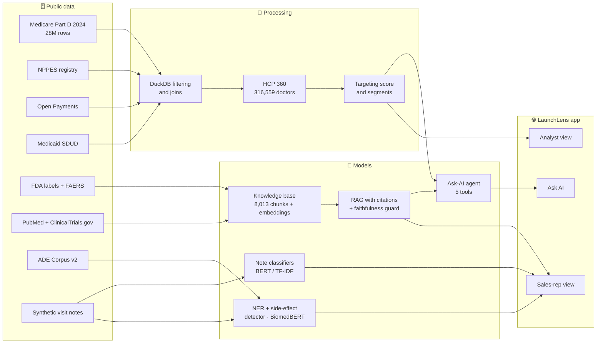
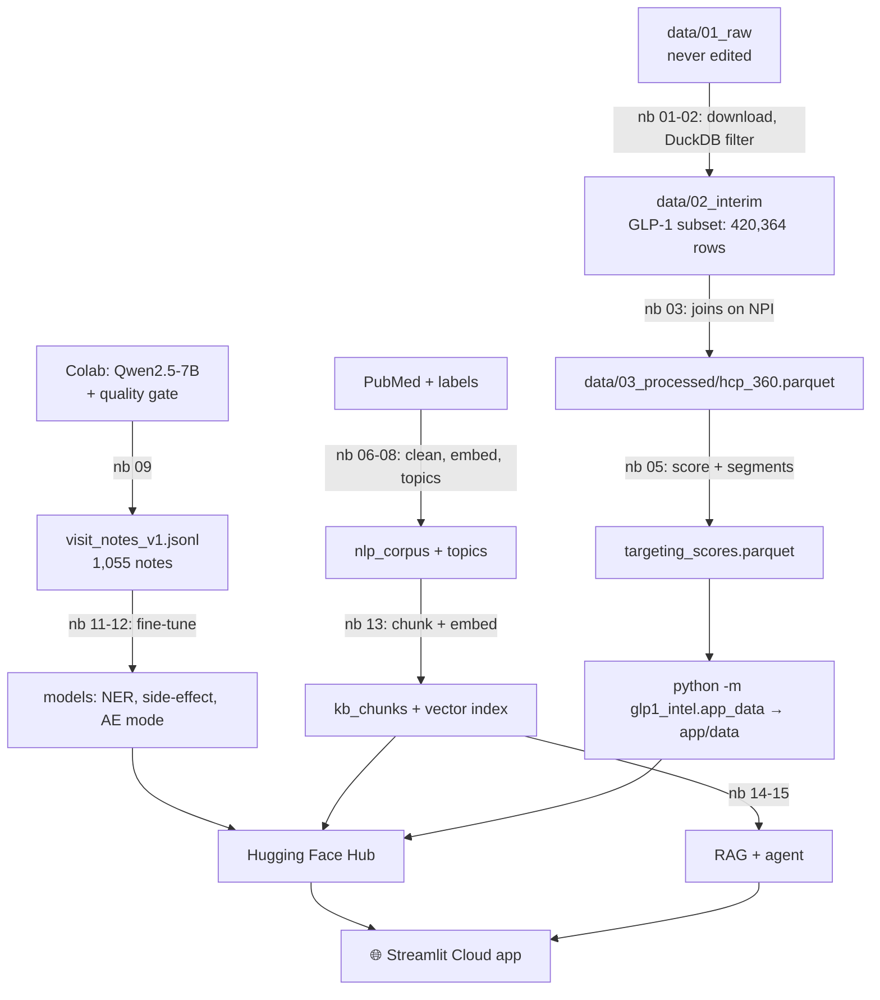
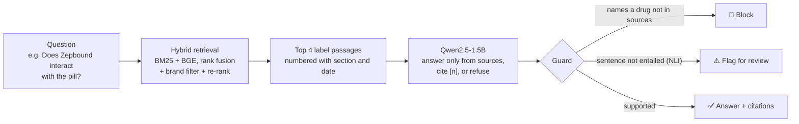
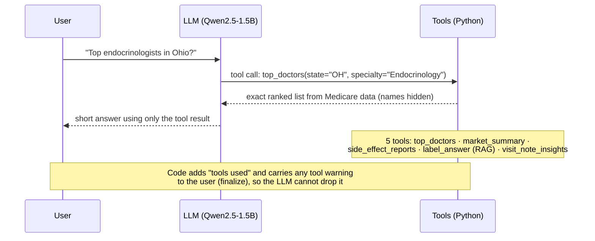
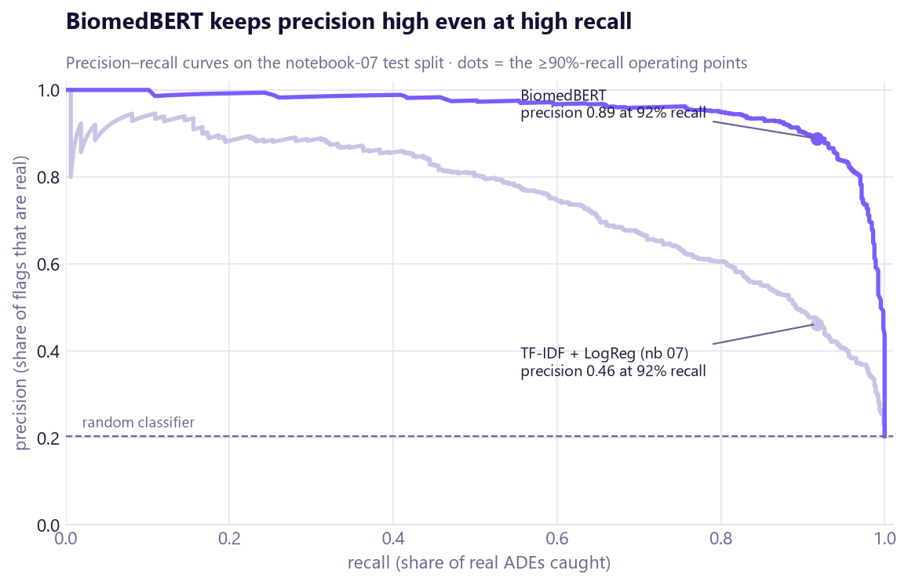
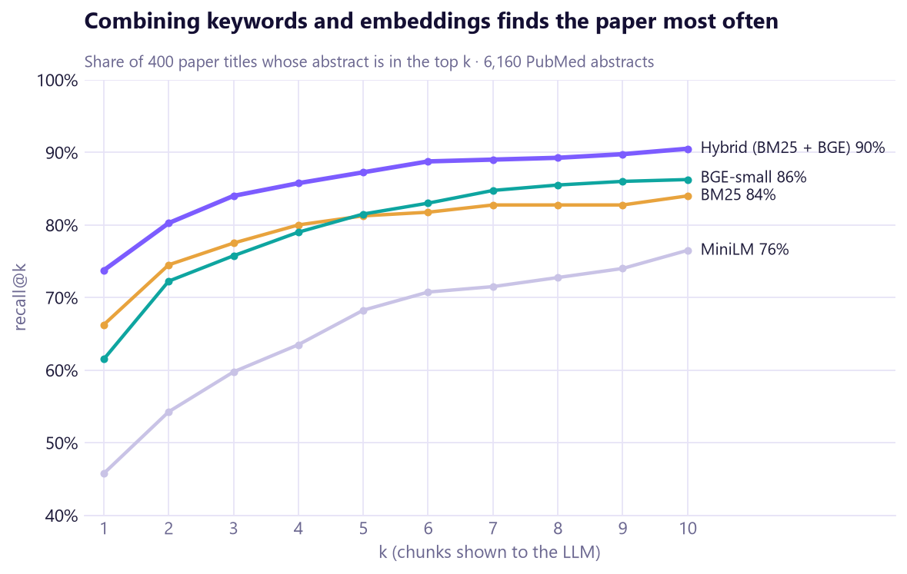
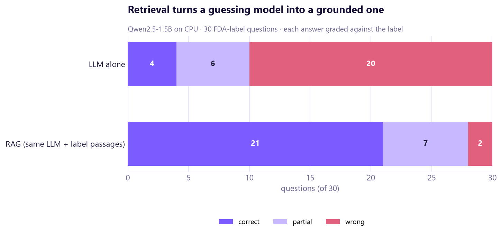
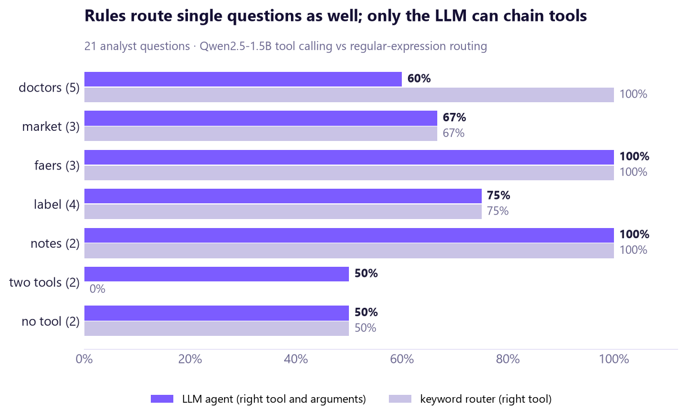
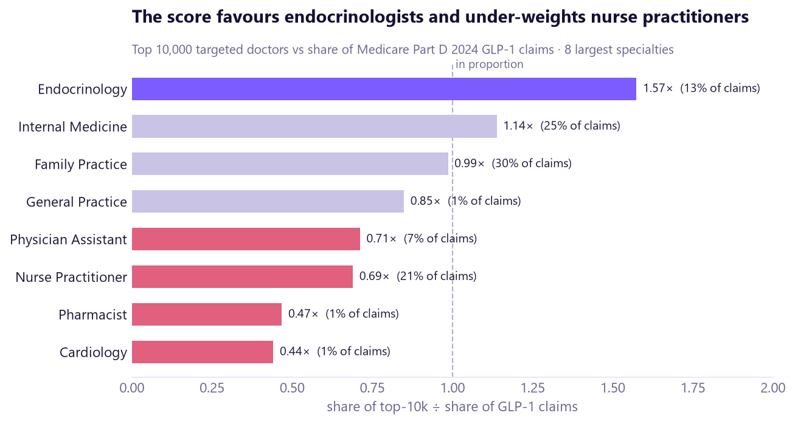
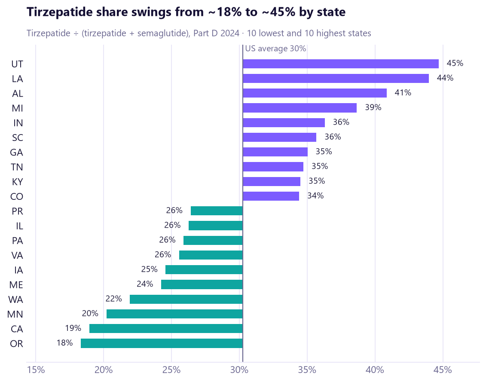

<div align="center">

# 🔭 LaunchLens · GLP-1 Launch Intelligence

**Open-source AI analytics for pharma sales-optimization teams, built for the 2026 GLP-1 market shift.**
Which doctors to prioritise, why, and what to say: real public US data, explainable models, and evaluation with the failures shown.

[](https://www.python.org/)
[](https://glp1-launchlens.streamlit.app/)
[](https://huggingface.co/SwagataBhowmik)
[](https://huggingface.co/microsoft/BiomedNLP-BiomedBERT-base-uncased-abstract-fulltext)
[](https://duckdb.org/)
[](https://glp1-launchlens.streamlit.app/)
[](#-disclaimer-author-and-acknowledgements)

### [🚀 Open the live app](https://glp1-launchlens.streamlit.app/) · [🧭 Reviewer guide](https://glp1-launchlens.streamlit.app/guide) · [🤗 Models & data on Hugging Face](https://huggingface.co/SwagataBhowmik) · [📓 Notebooks](notebooks/README.md)

**Reviewing this project?** Start with the [website's guide page](https://glp1-launchlens.streamlit.app/guide), or download the one-file [project report](docs/project_report.html) (open it in a browser; it works offline).

</div>


---

## 🧭 Table of contents

1. [Project at a glance](#-project-at-a-glance)
2. [The problem](#-the-problem)
3. [Our solution and contribution](#-our-solution-and-contribution)
4. [Objectives and scope](#-objectives-and-scope)
5. [How it works](#%EF%B8%8F-how-it-works)
6. [Data](#%EF%B8%8F-data)
7. [Methods and concepts](#-methods-and-concepts)
8. [Notebook learning ladder](#-notebook-learning-ladder)
9. [Results](#-results)
10. [The app](#%EF%B8%8F-the-app)
11. [Repository structure](#-repository-structure)
12. [Setup and run](#%EF%B8%8F-setup-and-run)
13. [Limitations](#%EF%B8%8F-limitations)
14. [Future work](#%EF%B8%8F-future-work)
15. [Important links](#-important-links)
16. [Disclaimer, author and acknowledgements](#-disclaimer-author-and-acknowledgements)

---

## 📌 Project at a glance

| 🎯 Problem | 👥 Users | 🗄️ Data | 🧠 Methods | 🏆 Best results | 🌐 Live app |
|---|---|---|---|---|---|
| After the 2026 GLP-1 shift (first weight-loss **pill**, Medicare coverage for weight loss), sales teams must re-decide which doctors to see and what to discuss | **Analysts** (main) and **sales reps** (secondary) | 9 public US sources (Medicare Part D 2024: 28M rows; FDA labels and side-effect reports; PubMed; …) + an open **synthetic visit-notes** dataset (1,055 notes) | DuckDB SQL, transparent scoring, TF-IDF, embeddings, fine-tuned **BERT / BiomedBERT**, NER, hybrid search, **RAG**, a tool-using **agent**, LLM evaluation | Side-effect detection **F1 0.90** (baseline 0.69) · retrieval **97%** recall@5 · RAG **21/30** correct (LLM alone: 4/30) | [glp1-launchlens.streamlit.app](https://glp1-launchlens.streamlit.app/) |

> [!NOTE]
> **GLP-1** drugs copy a gut hormone that lowers blood sugar and appetite. They treat type 2 diabetes (e.g. Ozempic, Mounjaro, Trulicity) and obesity (e.g. Wegovy, Zepbound, and the new pill Foundayo). An **HCP** ("health-care professional") is a prescriber: a doctor, nurse practitioner or physician assistant.

---

## 🩺 The problem

In 2026 the US GLP-1 market changed twice:

1. **April 2026:** Foundayo (orforglipron) is approved, the first GLP-1 weight-loss **pill**, so patients who avoid injections are now an audience.
2. **July 2026:** Medicare starts paying for GLP-1 weight-loss treatment through the **Medicare GLP-1 Bridge**, so millions of older patients gain coverage.

Sales-optimization teams must quickly re-answer *which doctors matter now, and why*. The evidence exists, but it is scattered:
- prescribing data (tens of millions of rows)
- industry-payment records
- research papers
- FDA labels and side-effect reports
- unstructured field notes that nobody reads at scale

> [!IMPORTANT]
> **The gap.** Commercial platforms such as Veeva, ZS and IQVIA already do HCP targeting and AI briefs *inside* companies. Their data, models and evaluations are closed. There is no open, end-to-end, evaluated reference that shows how such a system is built on public data, and where it fails.

---

## 💡 Our solution and contribution

LaunchLens is that open reference: one pipeline from raw public data to a live app, with every model measured against a baseline.

| What is new here | Why it matters |
|---|---|
| 🔓 **Fully open**: code, notebooks, models and app data | Anyone can rerun, inspect or extend it |
| 🇺🇸 **Real public US data**, not toy data | Numbers reflect the actual 2024 Medicare market (199,831 GLP-1 prescribers, 19.6M claims) |
| 📏 **Evaluated, failures included** | Confidence intervals, hand-graded answers, a guardrail test suite and a fairness audit, all published |
| 🧪 **Open synthetic visit-notes dataset** | Real rep notes are never public; 1,055 labelled synthetic notes let anyone benchmark pharma field-note NLP |
| 📅 **Focused on the 2026 shift** | Oral pill launch and Medicare coverage, not a generic dashboard |

> [!TIP]
> The product idea is **not** new. The contribution is doing it openly, on real data, with honest evaluation.

---

## 🎯 Objectives and scope

| ✅ In scope | ❌ Out of scope |
|---|---|
| One profile per doctor from public data (HCP 360) | Real company CRM data, sales figures or field notes |
| Transparent, explainable targeting score and segments | Telling doctors what to prescribe |
| NLP on papers, labels and (synthetic) visit notes | Real-time data feeds (Part D is published yearly) |
| Retrieval-augmented answers with citations and checks | A validated compliance (MLR) or pharmacovigilance system |
| A tool-using AI agent over the project's data | Logins, multi-user storage, production security |
| A live public app for analysts and reps | Commercial-insurance (non-Medicare) prescribing |

---

## ⚙️ How it works



**Each stage in plain words:**

1. **Collect.** Download nine public sources. The 4.4 GB Medicare file is streamed with **DuckDB**, an in-process SQL engine that queries big files without loading them into memory.
2. **Unify.** Join everything on the **NPI** (each US prescriber's unique ID) into **HCP 360**, one row per doctor: 316,559 doctors × 61 columns.
3. **Score.** Rank the 308,303 eligible doctors with a transparent weighted score (each doctor gets 3 plain-English reasons) and sort them into 6 segments.
4. **Read text.** Train models that tag drugs and side effects, detect adverse-event sentences, and classify doctor objections in visit notes.
5. **Search.** Turn labels, papers and notes into a searchable knowledge base (keyword + meaning search).
6. **Answer.** A small open LLM answers questions **only from retrieved passages**, with citations, and a checker flags unsupported sentences.
7. **Act.** An agent chooses the right tool (doctor ranking, market data, side-effect reports, label answers, note search). Code computes every number.
8. **Serve.** A Streamlit app: a scrolling landing page, plus analyst, sales-rep and Ask-AI pages.

<details>
<summary><b>🔁 Pipeline from raw data to app (diagram)</b></summary>


</details>

<details>
<summary><b>🔎 RAG flow: how a label question gets a cited answer</b></summary>


</details>

<details>
<summary><b>🤖 Agent flow: how Ask AI uses tools</b></summary>


</details>

---

## 🗄️ Data

| Dataset | Source | What it contains | Size | How it is used |
|---|---|---|---|---|
| **Medicare Part D Prescribers by Provider and Drug, 2024** | [data.cms.gov](https://data.cms.gov/provider-summary-by-type-of-service/medicare-part-d-prescribers) | Prescriptions per doctor per drug | 4.43 GB, 28,023,892 rows → GLP-1 subset 420,364 rows, 199,831 prescribers | Market sizing, HCP 360, targeting |
| **NPPES NPI Registry** (Oct 2026) | [CMS NPPES](https://download.cms.gov/nppes/NPI_Files.html) | Every prescriber's specialty, address, status | 1.16 GB zip (streamed, never unzipped) | Specialty, location; drops deactivated NPIs |
| **Open Payments** 2024–2025 | [openpaymentsdata.cms.gov](https://openpaymentsdata.cms.gov/) | Industry payments to doctors (rows for the two leading GLP-1 manufacturers) | 1,050,922 + 946,688 rows | "Industry contact" signal (company-neutral in the app) |
| **Medicaid State Drug Utilization** 2024–Q1 2026 | [data.medicaid.gov](https://data.medicaid.gov/) | GLP-1 prescriptions per state per quarter | 26,202 rows | Latest trend: the Q1 2026 coverage cuts |
| **openFDA drug labels** | [open.fda.gov](https://open.fda.gov/apis/drug/label/) | Prescribing information for 9 GLP-1 brands | 9 labels → 798 text chunks | RAG answers, verbatim label facts |
| **openFDA FAERS** | [open.fda.gov](https://open.fda.gov/apis/drug/event/) | Aggregated side-effect report counts, 6 molecules | e.g. tirzepatide 160,551 reports (2022–Q2 2026) | Safety page, agent tool |
| **PubMed** | [pubmed.ncbi.nlm.nih.gov](https://pubmed.ncbi.nlm.nih.gov/) | Abstracts, authors, affiliations (4 queries) | 8,900 papers → 6,160 abstracts after de-duplication | Topics, KOL links, retrieval |
| **ClinicalTrials.gov** (v2 API) | [clinicaltrials.gov](https://clinicaltrials.gov/) | Studies for 7 GLP-1 molecules | 1,871 studies | Research activity, investigator links |
| **ADE Corpus v2** | [Hugging Face](https://huggingface.co/datasets/ade-benchmark-corpus/ade_corpus_v2) | Sentences labelled "describes an adverse drug event" or not | 20,896 sentences after de-duplication | Training the side-effect detector |
| 🧪 **Synthetic visit notes v1** (this project) | [Dataset card](data/04_synthetic_visit_notes/DATASET_CARD.md) | Rep notes with objections, side-effect mode, NER spans | 1,055 notes (738 / 159 / 158 split) | Training note classifiers and NER |

<details>
<summary><b>🧹 How raw data became HCP 360</b></summary>

- **Raw stays raw.** `data/01_raw/` is never edited. Every change happens in code: `01_raw → 02_interim → 03_processed`.
- **GLP-1 filter (notebook 02).** DuckDB keeps 7 generic names: tirzepatide, semaglutide, dulaglutide, liraglutide, exenatide, exenatide microspheres, insulin degludec/liraglutide. GLP-2 and other combination products are excluded. Result: 420,364 rows and 199,831 prescribers in about 1 minute.
- **HCP 360 (notebook 03).** Joining on NPI gives **316,559 doctors** (199,831 GLP-1 prescribers + 116,728 diabetes prescribers who don't yet use GLP-1s) × 61 columns. NPPES matched 99.6% of NPIs, and code assertions check that the claims total reconciles (19,620,006). Column meanings are in the [data dictionary](docs/hcp_360_data_dictionary.md).
- **Eligible for targeting (notebook 05).** Deactivated NPIs and trainees are removed, leaving **308,303 scored doctors**.
</details>

<details>
<summary><b>🧪 How the synthetic visit notes were made, and quality-gated</b></summary>

- **Why synthetic:** real field notes are confidential.
- **Labels first:** 1,200 scenarios fixed the labels before any text existed (interest level, objections, side-effect mode, drugs). Specialties and states come from Medicare data; side-effect terms are sampled by real FAERS frequencies.
- **Generator:** Qwen2.5-7B-Instruct (open, Apache 2.0), 4-bit, on a free Colab GPU ([generator notebook](notebooks/colab/09a_generate_visit_notes_colab.ipynb)).
- **Quality gate:** rule checks reject notes that miss a required drug or side effect, mention unlisted brands, or copy the prompt. Rejected notes are regenerated. 1,108 passed in Colab; **1,055** remain after the tightened gate.
- **Labels by construction:** NER tags (DRUG, ADVERSE_EVENT, DOSE) come from lexicon matching. Diversity: distinct-3 = 0.61, with no near-duplicates.
- A 100-note **human hand-labelling check** is prepared but not done yet (TBD - needs confirmation).
</details>

---

## 🧠 Methods and concepts

| Concept | In plain English | Where it is used |
|---|---|---|
| **SQL analytics with DuckDB** | Query multi-GB files with SQL, directly from disk | Filter 28M Medicare rows (nb 02), app tables |
| **Segmentation and scoring** | Group doctors by behaviour; rank them with a weighted, explainable score | 6 segments + 0–100 score with 3 reasons each (nb 05) |
| **TF-IDF + logistic regression** | Count informative words, then fit a simple linear classifier | Baselines for every text task (nb 07, 11) |
| **Word embeddings** | Vectors where similar words sit close together | Word2Vec/fastText on PubMed (nb 08) |
| **BERTopic** | Clusters documents by meaning and names each cluster | Research themes and emerging topics (nb 08) |
| **Attention and BERT** | Each word "looks at" the others to understand context | Explained from scratch with NumPy (nb 10) |
| **Fine-tuning** | Further training a pretrained model on our labelled task | BERT / BiomedBERT note classifiers (nb 11) |
| **NER (named-entity recognition)** | Tag words as drug, side effect or dose | Highlights in "Log a visit" (nb 12) |
| **Adverse-event (ADE) detection** | Does a sentence describe a drug side effect? | Safety-review flag, tuned for ≥90% recall (nb 07, 12) |
| **Sentence embeddings and vector search** | Find text by meaning, not exact words | MiniLM / BGE-small over 8,013 chunks, FAISS (nb 13) |
| **Hybrid BM25 + BGE retrieval** | Combine keyword and meaning search with rank fusion | The retriever behind RAG and the agent (nb 13) |
| **RAG with citations and faithfulness** | The LLM answers only from retrieved passages and cites them; an NLI model checks each sentence is supported | Label Q&A, pre-visit brief (nb 14) |
| **Tool-using agent** | The LLM picks a tool and arguments; code runs it and returns exact numbers | Ask AI (nb 15) |
| **LLM-as-judge** | An LLM grades answers; validated against human grades | Evaluation report (nb 17) |
| **Guardrails and prompt-injection tests** | Automatic checks for unsafe or invented answers, plus planted hostile text | Guard, provenance flags, test suite (nb 14, 15, 17) |
| **Fairness audit** | Compare who the score selects with who does the prescribing | Representation by specialty and state (nb 17) |
| **Confidence intervals** | How much a score could move on a new test set of the same size | Bootstrap and Wilson 95% intervals (nb 11, 17) |

---

## 📓 Notebook learning ladder

Every notebook teaches the theory in plain language, then applies it, and ends with interview questions. Text claims are checked against the outputs.

| # | Notebook | What it teaches | What it produces |
|---|---|---|---|
| 01 | Data collection | Public APIs, streaming, resumable downloads | `data/01_raw/` (9 sources) |
| 02 | Part D filter & profile | DuckDB on 28M rows | GLP-1 subset (420,364 rows) |
| 03 | HCP 360 | Joins, reconciliation, data dictionary | `hcp_360.parquet` (316,559 × 61) |
| 04 | Market landscape | Storytelling with charts | 7 figures; Medicaid coverage-cut finding |
| 05 | Segmentation & targeting | Scoring, robustness, k-means | `targeting_scores.parquet`, 6 segments |
| 06 | NLP foundations | Tokenisation, lemmas, regex, Zipf | Clean NLP corpus |
| 07 | Classical NLP | TF-IDF, metrics, thresholds, leakage | ADE baseline (F1 0.687) |
| 08 | Embeddings & topics | Word2Vec, LDA vs BERTopic | Research topics per doctor |
| 09 | Synthetic visit notes | LLM data generation, quality gates | 1,055-note dataset + card |
| 10 | Transformers explained | Self-attention, BERT, positional encoding | Concept demos |
| 11 | Fine-tuning | Hugging Face Trainer, bootstrap CIs | Note classifiers |
| 12 | NER & ADE detection | Token classification, BIO tags | NER (F1 0.983), ADE model (F1 0.904) |
| 13 | Embeddings & vector search | Chunking, BM25, FAISS, hybrid, re-ranking | Knowledge base + retriever |
| 14 | RAG | Grounding, citations, NLI faithfulness | RAG pipeline + guard |
| 15 | LLM agent | Function calling, agent evaluation | Ask-AI agent |
| 16 | LoRA fine-tuning | Parameter-efficient tuning | *Planned (needs a Colab GPU)* |
| 17 | Evaluation report | CIs, LLM-as-judge, guardrails, fairness | Project scorecard |

<details>
<summary><b>Full file names</b></summary>

`01_data_collection_public_apis` · `02_part_d_glp1_filter_and_profile` · `03_build_hcp_360_doctor_table` · `04_glp1_market_landscape_eda` · `05_doctor_segmentation_and_targeting` · `06_nlp_foundations_text_preprocessing` · `07_classical_nlp_tfidf_baselines` · `08_word_embeddings_and_topic_modeling` · `09_synthetic_visit_notes_generation_and_labeling` · `10_transformers_explained_attention_to_bert` · `11_finetune_visit_note_classifier_huggingface` · `12_ner_and_adverse_event_detection` · `13_sentence_embeddings_and_vector_search` · `14_rag_pre_visit_brief` · `15_llm_agent_ask_ai` · `17_evaluation_guardrails_report` (all `.ipynb`, in [`notebooks/`](notebooks/README.md)).
</details>

---

## 📊 Results

| Task | Test set | Best model | Score [95% interval] | Baseline |
|---|---|---|---|---|
| Adverse-event sentence detection | 3,135 sentences | Fine-tuned BiomedBERT | **F1 0.90** [0.89–0.92] | TF-IDF 0.69 |
| … at ≥90% recall (reviewer workload) | 3,135 sentences | BiomedBERT | **73 false alarms**, precision 0.89 | TF-IDF: 673 false alarms, precision 0.47 |
| Visit-note objections (7 labels) | 158 notes | TF-IDF + LogReg | **macro-F1 0.94** [0.91–0.97] | BiomedBERT 0.91 · BERT 0.85 |
| Visit-note side-effect context (4 classes) | 158 notes | Fine-tuned BERT | **macro-F1 0.97** [0.94–1.00] | TF-IDF 0.86 · BiomedBERT 0.94 |
| NER: drugs, side effects, doses | 158 notes | BiomedBERT | **entity F1 0.98** (drug 1.00, side effect 0.95, dose 0.62 on 5 cases) | vs lexicon labels |
| Retrieval: paper title → abstract | 400 queries | Hybrid BM25 + BGE | **recall@5 0.87** [0.84–0.90] | BM25 0.81 · BGE 0.82 · MiniLM 0.68 |
| Retrieval: label questions | 30 questions | Hybrid BM25 + BGE | **recall@5 0.97** [0.83–0.99] | BM25 0.73 |
| RAG answers (hand-graded) | 30 questions | Qwen2.5-1.5B + retrieval | **21/30 correct** [0.52–0.83]; 77% of sentences supported | Same LLM alone: 4/30; 29% supported |
| Ask-AI agent (hand-graded) | 21 questions | Qwen2.5-1.5B + 5 tools | **12/21 correct** [0.37–0.76]; right tool 81%, right tool + filters 71% | Keyword router: right tool 76% |


*What to notice: large test sets give tight intervals (top rows). The small hand-graded LLM tests are the least certain, yet RAG still clearly beats the LLM alone.*

> [!WARNING]
> **What the evaluation found (notebook 17)**
> - **A small LLM is a poor judge.** Grading answers, it agreed with human grades only **52%** of the time (Cohen's κ 0.28). It was lenient, and would make the RAG advantage look smaller than it is.
> - **The guardrail suite passes 7 of 10 tests.** **1 of 3 prompt-injection attacks worked**: the model answered "YES [1]" by citing a planted fake source. Two unanswerable questions got confident invented answers, which the guard later caught. 127 of 128 numbers in agent answers trace back to a tool.
> - **Fairness gap.** Nurse practitioners write **21%** of GLP-1 claims but make up only **14%** of the top-10,000 targeting list (0.69×). Endocrinologists are over-represented 1.57×.
>
> The failures are documented, not hidden.

<details>
<summary><b>More result figures</b></summary>


*BiomedBERT keeps precision high even at high recall: far fewer false alarms for a safety reviewer.*


*Combining keyword and meaning search finds the right paper most often at every k.*


*Same 1.5B model: 21/30 correct with retrieved label passages, 4/30 without.*


*Simple rules route single questions as well as the LLM; only the LLM can chain tools.*


*The score favours endocrinologists and under-weights nurse practitioners: a business choice that should be stated openly.*


*Tirzepatide's share swings from about 18% (Oregon) to 45% (Utah): local factors matter more than the molecule.*
</details>

<details>
<summary><b>Extra metrics</b></summary>

- **Targeting robustness:** randomly changing every weight by ±20% keeps 96.5% of the top-10,000 doctors (Spearman 0.999).
- **k-means** (silhouette 0.50) found a 35k-doctor oral-semaglutide cluster, suggesting an "oral-ready" flag for the new pill.
- **Leakage check:** before de-duplication, ADE cross-validated F1 was 0.84; the honest score after de-duplication is 0.72.
- **Notes search:** precision@10 is BM25 0.77, BGE 0.83, hybrid 0.84.
- **Agent safety fix:** code-enforced provenance (`finalize()`) carries a tool's "verify before use" flag through to the user. This came from a real failure: the model read a hazard ratio of 0.80 as an "80% reduction" when it means a 20% lower risk.
</details>

---

## 🖥️ The app

**Live:** [glp1-launchlens.streamlit.app](https://glp1-launchlens.streamlit.app/). The front page is a scrolling landing site; the tools sit behind a glass menu at the top.

| View | Page | What it does |
|---|---|---|
| 🏠 | **Home** | Scrolling landing page: the 2026 story, key numbers, tool cards, proof |
| 📊 Analyst | **Market** | Brand shares, US state map, Medicaid trend to Q1 2026 |
| 📊 Analyst | **Find doctors** | Filterable ranked list with reasons, CSV export, segment mix and map |
| 📊 Analyst | **Doctor 360** | Look up a doctor by name or NPI; score breakdown |
| 📊 Analyst | **Safety** | FAERS side-effect report trends by molecule |
| 📊 Analyst | **Key numbers** | KPI cards and three data insights |
| 💼 Sales rep | **Pre-visit brief** | Territory → doctor → instant brief: profile, verbatim label facts with citations, boxed warning always shown, what similar doctors raise |
| 💼 Sales rep | **Log a visit** | Paste a note: drugs, side effects and doses highlighted, possible adverse event flagged for safety review, objections tagged |
| 🤖 | **Ask AI** | 21 evaluated questions with hand grades and tool traces, plus a live agent |

> [!NOTE]
> **Live-LLM features are switched off on the hosted app:** the live agent and the AI-written brief. They run a local LLM (Qwen2.5-1.5B) that needs about 6 GB of memory, more than the free Streamlit Cloud server has. In this "light mode" the note models also load in half precision (bfloat16) to fit. Run the app on a laptop to use everything. The 21 evaluated examples show exactly what the agent does.

---

## 📁 Repository structure

```text
GLP1-Launch-Intelligence/
├── app/                      # Streamlit app
│   ├── app.py                #   entry point: top menu, start-up asset download
│   ├── aurora.py             #   theme: glass cards, hero, glowing cursor, chart template
│   ├── requirements.txt      #   slim runtime deps used by Streamlit Cloud
│   ├── static/site/          #   scrolling landing page (HTML/CSS/JS + artwork)
│   └── views/                #   one file per page (landing, market, targeting, rep_brief, ask_ai, …)
├── src/glp1_intel/           # the Python package behind notebooks and app
│   ├── data_collection/      #   downloaders: openFDA, PubMed, CT.gov, Medicaid, Open Payments, NPPES, ADE
│   ├── data_processing/      #   HCP 360 build, KOL links
│   ├── models/               #   targeting score, fine-tuning, NER/ADE, note analyzer
│   ├── nlp/                  #   preprocessing, classical NLP, topics
│   ├── synthetic/            #   visit-note scenarios, generator, quality gate, dataset
│   ├── rag/                  #   knowledge base, retrieval, generation + guard, label facts
│   ├── agent/                #   tools, agent loop, evaluation
│   ├── evaluation/           #   LLM-as-judge + prompt-injection runs
│   ├── cloud.py              #   downloads data/models from Hugging Face; light mode
│   └── app_data.py           #   builds the small app tables
├── notebooks/                # learning ladder 01–17 (+ colab/09a generator)
├── data/                     # 01_raw → 02_interim → 03_processed (+ 04_synthetic_visit_notes, partly in Git)
├── reports/
│   ├── evaluation/           #   every metric as JSON, cached LLM answers, hand grades
│   └── figures/              #   all charts used in notebooks and this README
├── models/                   # fine-tuned models (git-ignored; published on Hugging Face)
├── deploy/                   # publish script (models + data to Hugging Face), Dockerfile
├── docs/                     # concept poster, UI mock-up, HCP 360 data dictionary
├── .github/workflows/        # GitHub Pages deploy for the landing site
├── requirements.txt          # full research stack
└── requirements-lock.txt     # exact versions the notebooks were run with
```

---

## 🛠️ Setup and run

**1 · Create the environment** (Python 3.11+)

```bash
py -3.11 -m venv .venv
.venv\Scripts\activate
pip install -r requirements.txt
pip install -e .
python -m spacy download en_core_web_sm
```

(Use `requirements-lock.txt` instead of `requirements.txt` for the exact versions. On macOS or Linux, activate with `source .venv/bin/activate`.)

**2 · Run the app quickly, without rebuilding the data.** Missing data and models download automatically from Hugging Face on first start (about 2 minutes):

```bash
streamlit run app/app.py
```

<details>
<summary><b>3 · Rebuild everything from raw data</b></summary>

1. Download the **Medicare Part D Prescribers by Provider and Drug 2024** CSV from data.cms.gov into `data/01_raw/medicare_part_d_prescribers/`. It is 4.4 GB; never open it in Excel.
2. Run notebook **01** to fetch the other public sources. They work directly through public APIs.
3. Run notebooks **02 → 17** in order. Long model jobs cache their results in `reports/evaluation/`, so notebooks load them instead of retraining.
4. Build the app tables:

```bash
python -m glp1_intel.app_data
```

5. Optional cached LLM batch runs (about 1 hour each on CPU, resumable):

```bash
python -m glp1_intel.rag.experiments
```

```bash
python -m glp1_intel.agent.evaluate
```

```bash
python -m glp1_intel.evaluation.llm_checks
```
</details>

| 📦 In Git | 🚫 Not in Git (and where to get it) |
|---|---|
| Code, notebooks with outputs, figures, metrics JSON, cached LLM answers and hand grades, synthetic notes (JSONL + card) | Raw data incl. the **4.4 GB CMS Part D file**: re-download (step 3) |
| Small landing-page artwork | Processed tables and embeddings: [HF dataset](https://huggingface.co/datasets/SwagataBhowmik/glp1-launch-intelligence-data) |
| | **Trained models** (~420 MB each): [Hugging Face](https://huggingface.co/SwagataBhowmik) |
| | Secrets (`.env`): never committed |

---

## ⚠️ Limitations

| Limitation | Why it matters | How to improve |
|---|---|---|
| Synthetic visit notes, lexicon-made NER labels | Models look better than they would on real notes | Hand-label a sample; test on real (consented) notes |
| Small hand-graded LLM test sets (21–30 questions) | Intervals of ±0.15–0.2; can't rank close variants | Grow to 100+ questions; add a second grader |
| Small CPU LLM (1.5B parameters) | Loose instruction-following; invents under leading questions | Use a 7B+ or API model; same evaluation applies |
| Prompt injection worked once in 3 tries | A poisoned document could make the system claim off-label use | Index only trusted sources; screen text at ingestion; add an off-label check |
| Medicare-only, 2024 prescribing | Misses commercial insurance and post-2024 behaviour | Add other payers when available; refresh yearly |
| Some labels are repackager copies (Wegovy from April 2024) | Answers can lag the current label | Pull manufacturer labels from DailyMed; refresh regularly |
| Targeting score ranks individuals | Under-weights team-based prescribers (NPs, PAs) | NP/PA track or practice-level targeting |
| Guardrails are demonstrations | Not a validated compliance or pharmacovigilance system | Human MLR review; validated safety intake |

---

## 🗺️ Future work

- [ ] **Notebook 16: LoRA fine-tuning** of a small LLM on a free Colab GPU
- [ ] **Larger LLM** for RAG, the agent and the judge; re-run the same evaluations
- [ ] **Hand-labelling check** of 100 synthetic notes (human vs generator labels, Cohen's κ)
- [ ] **Quality gate v2**: "no side effect" notes must contain no side-effect words; train objections models for 8 epochs
- [ ] **Off-label claim detector** and ingestion screening against prompt injection
- [ ] **Real field data** (consented, de-identified) to measure the domain gap
- [ ] **"Voice of doctors" page**: objection and topic trends from notes

---

## 🔗 Important links

| Resource | Link |
|---|---|
| 🌐 Live app | https://glp1-launchlens.streamlit.app/ |
| 🤗 Visit-note NER model | https://huggingface.co/SwagataBhowmik/glp1-visit-note-ner-biomedbert |
| 🤗 Adverse-event sentence detector | https://huggingface.co/SwagataBhowmik/glp1-ade-sentence-biomedbert |
| 🤗 Side-effect context classifier | https://huggingface.co/SwagataBhowmik/glp1-visit-note-ae-mode-bert |
| 🤗 App data (tables, knowledge base) | https://huggingface.co/datasets/SwagataBhowmik/glp1-launch-intelligence-data |
| 🧪 Synthetic dataset card | [data/04_synthetic_visit_notes/DATASET_CARD.md](data/04_synthetic_visit_notes/DATASET_CARD.md) |
| 📓 Notebooks README | [notebooks/README.md](notebooks/README.md) |
| 📖 HCP 360 data dictionary | [docs/hcp_360_data_dictionary.md](docs/hcp_360_data_dictionary.md) |
| CMS Medicare Part D Prescribers | https://data.cms.gov/provider-summary-by-type-of-service/medicare-part-d-prescribers |
| CMS NPPES | https://download.cms.gov/nppes/NPI_Files.html |
| CMS Open Payments | https://openpaymentsdata.cms.gov/ |
| Medicaid State Drug Utilization | https://data.medicaid.gov/ |
| openFDA (labels, FAERS) | https://open.fda.gov/ |
| PubMed | https://pubmed.ncbi.nlm.nih.gov/ |
| ClinicalTrials.gov | https://clinicaltrials.gov/ |
| ADE Corpus v2 | https://huggingface.co/datasets/ade-benchmark-corpus/ade_corpus_v2 |

---

## 📜 Disclaimer, author and acknowledgements

> [!CAUTION]
> Independent portfolio project using only **public and synthetic** data. Not affiliated with or endorsed by any pharmaceutical company. **Not medical advice.** Doctor names come from public CMS registries. Targeting decides who receives label-consistent information first, never what a doctor should prescribe.

**License:** TBD - needs confirmation (no LICENSE file in the repository yet).

**Author:** **Swagata Bhowmik**, MSc Data Science, NMIMS · [Hugging Face](https://huggingface.co/SwagataBhowmik) · [GitHub](https://github.com/Swagata-Bhowmik) · [LinkedIn](https://www.linkedin.com/in/swagata-bhowmik/)

**Acknowledgements:**
- **Data:** CMS (Medicare Part D, NPPES, Open Payments, Medicaid SDUD), the U.S. FDA (openFDA), NCBI PubMed, ClinicalTrials.gov, and the ADE Corpus v2 authors.
- **Open models and tools:** Microsoft BiomedBERT, Google BERT, Qwen2.5 (Alibaba), BGE-small (BAAI), sentence-transformers, Hugging Face, DuckDB, FAISS, Streamlit and Streamlit Community Cloud.
