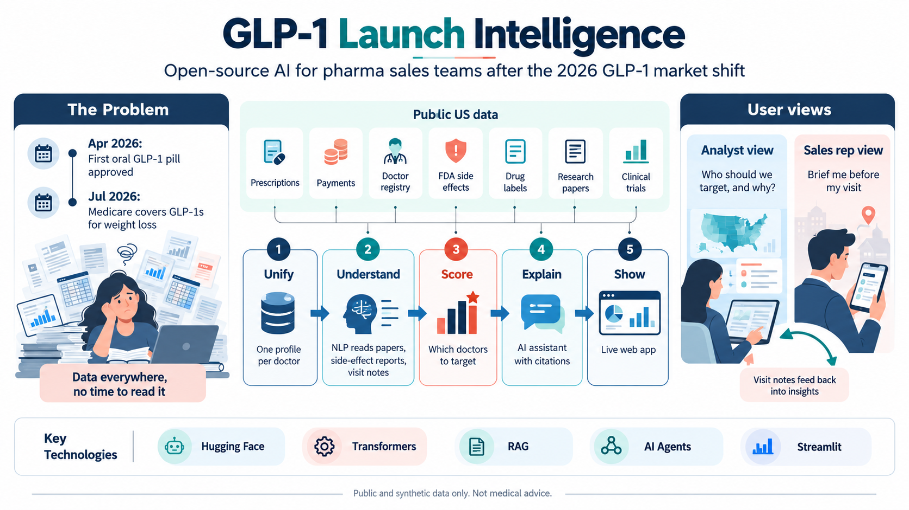
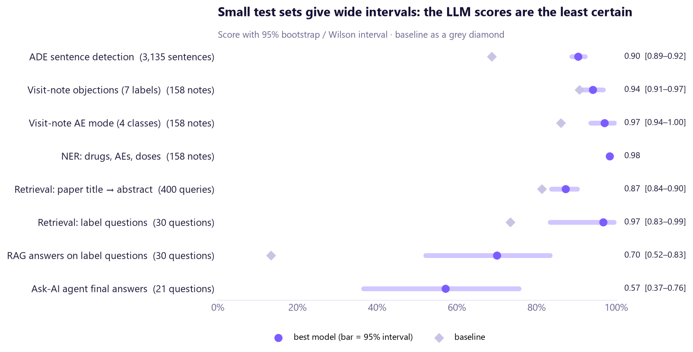

# GLP-1 Launch Intelligence

**An open-source AI platform that helps pharma sales-optimization teams decide which doctors to target after the 2026 GLP-1 market shift, built on real public US data with NLP, transformers, RAG and AI agents, and evaluated end to end.**

### 🔗 Live app: **[glp1-launchlens.streamlit.app](https://glp1-launchlens.streamlit.app/)**
Models on Hugging Face: [visit-note NER](https://huggingface.co/SwagataBhowmik/glp1-visit-note-ner-biomedbert) · [adverse-event detector](https://huggingface.co/SwagataBhowmik/glp1-ade-sentence-biomedbert) · [side-effect context](https://huggingface.co/SwagataBhowmik/glp1-visit-note-ae-mode-bert) · [app data](https://huggingface.co/datasets/SwagataBhowmik/glp1-launch-intelligence-data)



## Why
In 2026 the US GLP-1 (diabetes / weight-loss) market changed:
- **April:** the first oral GLP-1 pill for obesity (orforglipron, *Foundayo*) was approved.
- **July:** Medicare began covering these drugs for weight loss through the **Medicare GLP-1 Bridge**.

Sales teams must quickly rethink which doctors to focus on. The evidence is scattered across prescription data, research papers, side-effect reports, drug labels and unread field notes.

Commercial platforms (Veeva, ZS, IQVIA) already solve this inside companies. This project's contribution is to make it **open**:
- built on **real public data**
- **evaluated** step by step, failures included
- focused on the 2026 shift
- with an **open synthetic visit-notes dataset**

## What it does
- **Unifies** public data into one profile per doctor (HCP 360: 308,303 eligible prescribers)
- **Ranks** doctors with a transparent score and three reasons each, then audits who the score favours
- **Reads text**:
  - detects adverse events (side effects) in sentences
  - tags drugs, side effects and doses in visit notes
  - classifies doctor objections
- **Answers questions**:
  - RAG over FDA labels, with citations and faithfulness checks
  - a tool-using agent whose numbers always come from code
- Two views: 📊 **Analyst** (sales optimization) and 📱 **Sales rep** (pre-visit brief, visit-note analysis)

## Key results (test sets, with 95% intervals)
| Task | Test set | Best model | Score | Baseline |
|---|---|---|---|---|
| Adverse-event sentence detection | 3,135 sentences | fine-tuned BiomedBERT | **F1 0.90** [0.89–0.92] | TF-IDF 0.69 |
| … same, at ≥ 90% recall | 3,135 sentences | BiomedBERT | **73 false alarms** | TF-IDF 673 |
| Visit-note objections (7 labels) | 158 notes | TF-IDF + LogReg | **macro-F1 0.94** [0.91–0.97] | BiomedBERT 0.91 |
| Visit-note side-effect context (4 classes) | 158 notes | fine-tuned BERT | **macro-F1 0.97** [0.94–1.00] | TF-IDF 0.86 |
| NER: drugs, side effects, doses | 158 notes | BiomedBERT | **entity F1 0.98** | (vs lexicon labels) |
| Retrieval: label questions | 30 questions | hybrid BM25 + BGE | **recall@5 0.97** [0.83–0.99] | BM25 0.73 |
| RAG answers (hand-graded) | 30 questions | Qwen2.5-1.5B + retrieval | **21/30 correct** [0.52–0.83] | same LLM alone: 4/30 |
| Ask-AI agent (hand-graded) | 21 questions | Qwen2.5-1.5B + 5 tools | **12/21 correct** [0.37–0.76] | – |

What the evaluation found (notebook 17):
- **A small LLM is a poor judge.** As a grader it agrees with the hand grades only 52% of the time (κ 0.28), and it is lenient.
- **The guardrail suite passes 7 of 10 tests.** One of 3 prompt-injection attacks worked.
- **The targeting score under-weights some groups.** Nurse practitioners write 21% of GLP-1 claims but are 14% of the top 10,000.

The failures are documented, not hidden.



## App (Streamlit)
| View | Page | What it does |
|---|---|---|
| Analyst | Overview · Market · Targeting · Doctor 360 · Safety signals | market shares, state map, Medicaid coverage cuts, ranked doctor list with reasons, doctor lookup, FAERS trends |
| Sales rep | **Pre-visit brief** | territory → doctor → instant brief: profile from data, verbatim label facts with citations, boxed warning always shown, what similar doctors raise; optional AI draft |
| Sales rep | **Log a visit** | paste a note → drugs / side effects / doses highlighted, possible adverse event flagged for safety review, objections tagged (~0.2 s) |
| AI assistant | **Ask AI** | 21 evaluated example questions with hand grades and tool traces, plus a live agent (local LLM, ~1–3 min on CPU) |

The hosted app runs on Streamlit Community Cloud's free server, so the two **live-LLM** features (the live agent and the AI-written brief) are switched off there. They need ~6 GB of memory and work when you run the app locally.

## Notebooks: a learning ladder from basics to agents
Each notebook teaches the theory in plain language, then applies it; every claim in the text is checked against the outputs. Full list: [`notebooks/README.md`](notebooks/README.md).

| Stage | Notebooks |
|---|---|
| Data & analytics | 01 public APIs · 02 DuckDB on 28M rows · 03 HCP 360 table · 04 market EDA · 05 segmentation & targeting |
| Classical NLP | 06 preprocessing · 07 TF-IDF baselines · 08 word embeddings & BERTopic |
| Data & transformers | 09 synthetic visit notes (LLM-generated, quality-gated) · 10 attention → BERT · 11 fine-tuning · 12 NER & adverse events |
| Retrieval & LLMs | 13 sentence embeddings & vector search · 14 RAG with citations & faithfulness · 15 tool-using agent |
| Evaluation | 17 scorecard, LLM-as-judge, guardrail tests, prompt injection, fairness audit |
| Stretch | 16 LoRA fine-tuning (Colab GPU, planned) |

## Data (public)
CMS Medicare Part D Prescribers (2024) · CMS Open Payments · NPPES NPI Registry · Medicaid State Drug Utilization · openFDA FAERS & drug labels · PubMed · ClinicalTrials.gov · ADE Corpus v2 · plus a **synthetic, clearly labelled** rep visit-notes dataset ([dataset card](data/04_synthetic_visit_notes/DATASET_CARD.md)).

All models and LLMs are **free and run locally**: BiomedBERT, BERT, MiniLM, BGE-small, an MS MARCO cross-encoder, a DeBERTa NLI model and Qwen2.5-1.5B-Instruct. No API key is needed.

## Setup
```bash
py -3.11 -m venv .venv
.venv\Scripts\activate
pip install -r requirements.txt        # or requirements-lock.txt for exact versions
pip install -e .                       # the project package (src/glp1_intel)
python -m spacy download en_core_web_sm
```
The raw CMS Part D 2024 file (4.4 GB) is not in Git; see `data/README.md` for sources. Trained models are not in Git either: notebooks 11–12 create them in `models/`.

### Run the app
```bash
python -m glp1_intel.app_data      # builds the small tables in app/data/ (after notebooks 02-05)
streamlit run app/app.py
```

## Limitations
- **Small hand-graded sets.** The LLM evaluations use 21–30 questions, so their intervals are wide (±0.15–0.2).
- **Synthetic visit notes.** The notes and the lexicon-based NER labels make notebooks 11–12 look better than real field data would.
- **CPU-sized LLM.** A 1.5B model on a laptop is free and private, but slow, and it follows instructions loosely. The same pipeline can call a larger model.
- **Educational guardrails.** The checks demonstrate ideas such as fair balance, on-label answers and adverse-event triage. They are not a validated compliance or pharmacovigilance system.

## Disclaimer
Independent portfolio project using only public and synthetic data. Not affiliated with or endorsed by any pharmaceutical company. Not medical advice.

## Author
**Swagata Bhowmik**, MSc Data Science, NMIMS · [Hugging Face](https://huggingface.co/SwagataBhowmik) · [GitHub](https://github.com/Swagata-Bhowmik) · [LinkedIn](https://www.linkedin.com/in/swagata-bhowmik/)
