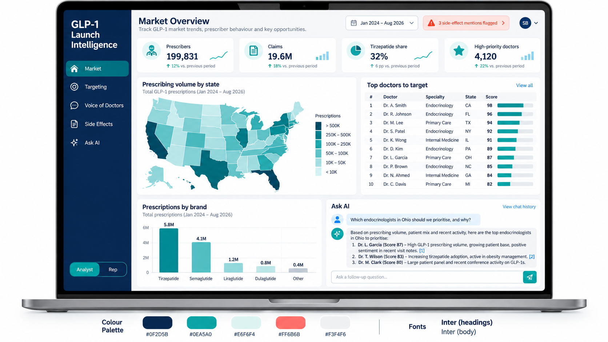

# GLP-1 Launch Intelligence

**An open-source AI platform that helps pharma sales-optimization teams decide which doctors to target after the 2026 GLP-1 market shift, built on real public US data with NLP, transformers, RAG and AI agents.**


> 🚧 Work in progress (started Oct 2026). Live demo, models and dataset links will appear here.

## Why
In 2026 the US GLP-1 (diabetes / weight-loss) market changed: the first oral GLP-1 pill for obesity (orforglipron, *Foundayo*) was approved in April, and from July Medicare began covering these drugs for weight loss through the **Medicare GLP-1 Bridge**. Sales teams must quickly rethink which doctors to focus on, but the evidence is scattered across prescription data, payments, research papers, side-effect reports, drug labels and unread field notes.

## What it does
- **Unifies** public data into one profile per doctor (HCP 360)
- **Understands** text with NLP: research interests, visit-note objections, competitor mentions, side-effect detection
- **Ranks** doctors for targeting, with reasons
- **Explains** via an AI assistant (RAG + tool-using agent) that cites its sources
- Two views: 📊 **Analyst** (sales optimization) and 📱 **Sales rep** (pre-visit brief, note analysis)

### Planned analyst dashboard (design mockup, illustrative numbers)


## Data (public)
CMS Medicare Part D Prescribers (2024) · CMS Open Payments · NPPES NPI Registry · Medicaid State Drug Utilization · openFDA FAERS & drug labels · PubMed · ClinicalTrials.gov · ADE Corpus v2 · plus a **synthetic, clearly labelled** rep visit-notes dataset.

## NLP / AI covered
Text preprocessing & tokenisation → TF-IDF baselines → word embeddings & topic modelling (BERTopic) → fine-tuned BERT/PubMedBERT (classification, NER, adverse-event detection) → sentence embeddings & vector search → RAG → LLM agents → LoRA fine-tuning → evaluation & guardrails.

## Setup
```bash
py -3.11 -m venv .venv
.venv\Scriptsctivate
pip install -r requirements.txt        # or requirements-lock.txt for exact versions
pip install -e .                       # the project package (src/glp1_intel)
python -m spacy download en_core_web_sm
```
The raw CMS Part D 2024 file (4.4 GB) is not in Git; see `data/README.md` for sources.

### Run the analyst dashboard
```bash
python -m glp1_intel.app_data      # builds the small tables in app/data/ (after notebooks 02-05)
streamlit run app/app.py
```
Pages: **Overview** · **Market** (brands, state map, Medicaid trend to Q1 2026) · **Targeting** (filterable ranked list with reasons, CSV export) · **Doctor 360** (lookup by name or NPI, score breakdown) · **Safety signals** (FAERS).

## Disclaimer
Independent portfolio project using only public and synthetic data. Not affiliated with or endorsed by any pharmaceutical company. Not medical advice.

## Author
**Swagata Bhowmik**, MSc Data Science, NMIMS · [Hugging Face](https://huggingface.co/SwagataBhowmik) · [GitHub](https://github.com/Swagata-Bhowmik) · [LinkedIn](https://www.linkedin.com/in/swagata-bhowmik/)
